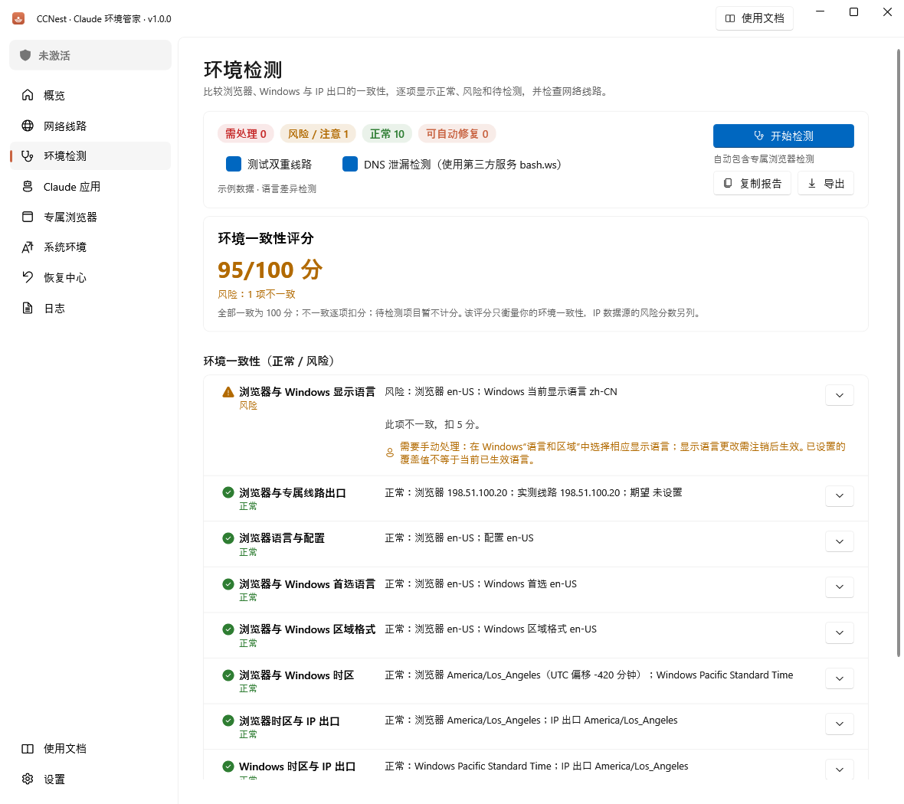
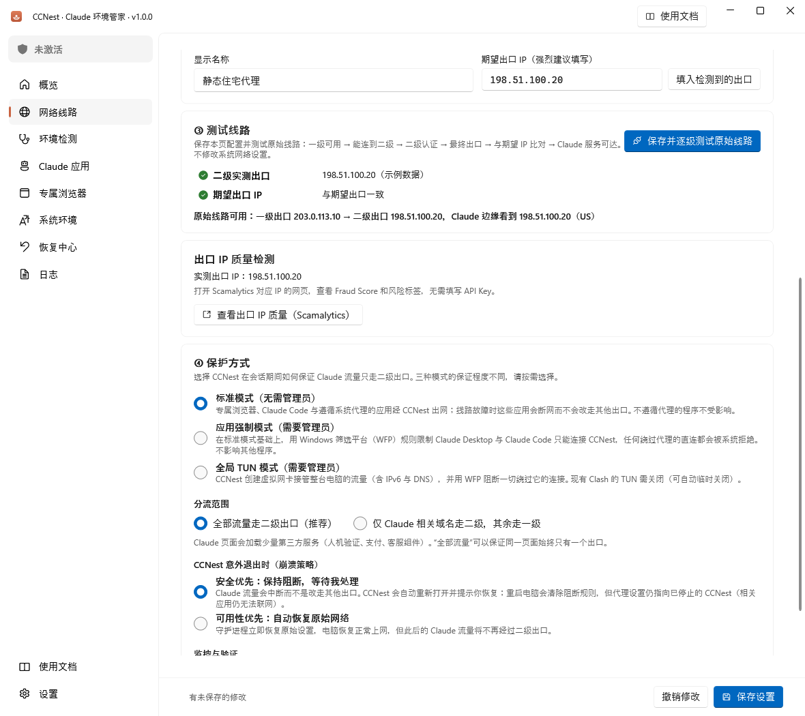
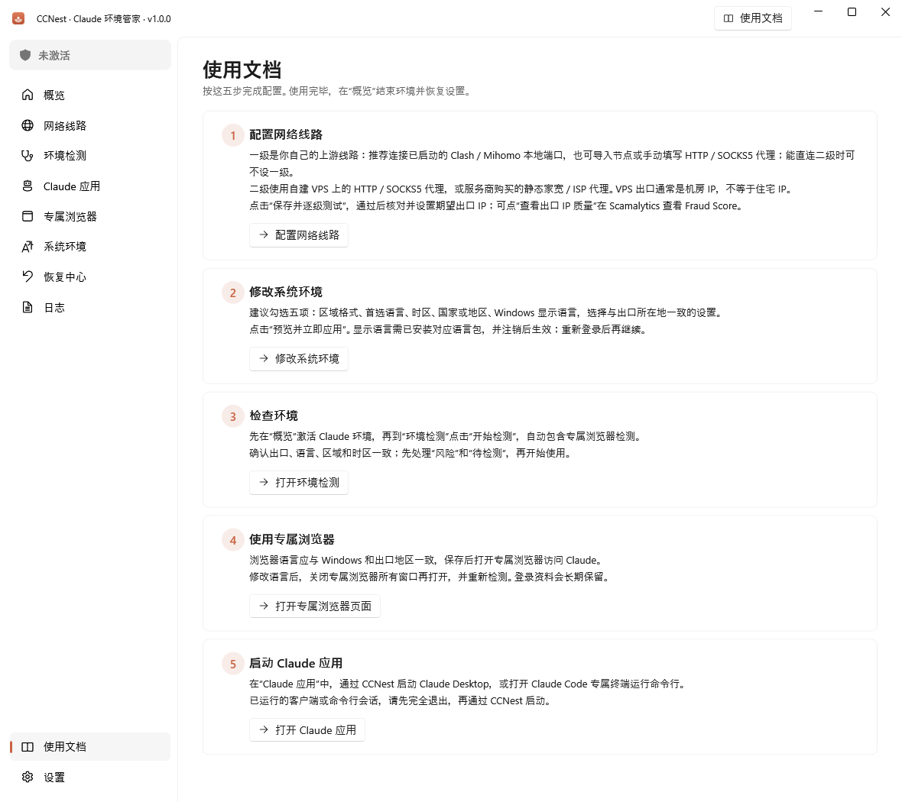

<div align="center">


# CCNest · Claude 环境管家

**把代理线路、Windows 环境和 Claude 启动入口放在一起。**

核对真实出口，一键检查环境差异，用完恢复原始设置。

[](https://github.com/BroderQi/CCNest/releases/latest)
[](https://github.com/BroderQi/CCNest/releases/latest)
[](https://github.com/BroderQi/CCNest/actions/workflows/release.yml)
[](LICENSE)

[下载最新版](https://github.com/BroderQi/CCNest/releases/latest) · [五步开始](#五步开始) · [使用文档](docs/QUICKSTART.md) · [反馈问题](https://github.com/BroderQi/CCNest/issues)

</div>

## 能做什么

- **串联自己的线路**：一级可接 Clash / Mihomo 本地端口、导入节点或手动代理；二级使用自建 HTTP / SOCKS5 代理，或购买的静态家宽 / ISP 代理。
- **核对实际出口**：逐级测试线路，比较实测 IP、期望 IP，以及 Claude 边缘节点看到的 IP。网络线路页可打开 Scamalytics，查看该出口的 Fraud Score。
- **一键检查环境**：点击“开始检测”，自动采集专属浏览器信息，对比浏览器、Windows 与出口的语言、区域和时区。一致显示正常，不一致指出差异，缺失数据标为待检测。
- **管理 Windows 设置**：预览后应用区域格式、首选语言、时区、国家或地区、显示语言；修改前保存原始值，支持恢复。
- **统一启动 Claude**：独立浏览器资料长期保留；也可从 CCNest 启动 Claude Desktop 或 Claude Code 专属终端。
- **线路异常时阻断**：经二级代理转发的连接失败时，不自动回退到一级或直连。可按需选择应用强制或全局 TUN 保护。

CCNest 不提供代理服务。**VPS 出口通常属于机房，不能当作住宅 IP；一致性评分也不代表 Claude 的账号风控判断。**

## 界面预览

以下为客户端实际界面，使用示例数据展示，不含真实账号或代理凭据。

**环境检测：一次检测，查看得分、具体差异和调整建议。**



| 网络线路与出口质量 | 客户端内置五步指引 |
| --- | --- |
| [](docs/screenshots/network.png) | [](docs/screenshots/guide.png) |

## 安装与更新

打开 [Releases](https://github.com/BroderQi/CCNest/releases/latest)，在 **Assets** 中选择：

| 文件 | 用法 |
| --- | --- |
| `CCNest-<版本>-win-x64-portable.zip` | 解压后运行 `CCNest.exe` |
| `CCNest-Setup-<版本>-x64.exe` | 按向导安装，适合长期使用 |
| `SHA256SUMS.txt` | 核对安装包和压缩包的 SHA-256 |

支持 **Windows 10 / 11 x64**。发布包已包含 .NET 运行时，无需另行安装。

升级前先结束当前环境并退出旧版，再安装或解压新版。配置、加密凭据和专属浏览器资料保存在 `%LOCALAPPDATA%\CCNest`，升级不会删除这些资料。当前客户端不会自动下载安装更新。

## 五步开始

1. **配置网络线路**：启动自己的上游线路，填写二级代理，保存并逐级测试。核对并设置期望出口 IP；需要时打开“出口 IP 质量检测”。能直连二级时，可不设一级。
2. **修改系统环境**：建议勾选五项，选择与出口地区一致的设置，点击“预览并立即应用”。显示语言需已安装语言包，注销后生效。
3. **检查环境**：在“概览”激活 Claude 环境，再到“环境检测”点击“开始检测”。先处理风险和待检测项。
4. **使用专属浏览器**：保持浏览器语言与 Windows、出口地区一致，通过专属浏览器访问 Claude。修改语言后关闭全部专属窗口，重新打开并检测。
5. **启动 Claude 应用**：通过 CCNest 启动 Claude Desktop，或打开 Claude Code 专属终端。已运行的客户端或命令行会话需先退出。

使用完毕，在“概览”点击 **结束并恢复原始设置**。客户端顶部也可随时打开完整[使用文档](docs/QUICKSTART.md)。

## 保护范围

| 模式 | 管理员权限 | 覆盖范围 |
| --- | --- | --- |
| 标准模式 | 无需 | 专属浏览器、已配置的 Claude Code，以及遵循系统代理的应用 |
| 应用强制 | 需要 | 增加 WFP 规则，限制 Claude Desktop / Claude Code 绕过 CCNest 联网 |
| 全局 TUN | 需要 | 虚拟网卡接管整机流量，配合 WFP 阻断绕过流量 |

标准模式无法强制覆盖所有程序或子进程。Anthropic 服务器上运行的云端功能，也不受本机线路控制。详细保证、已验证场景和限制见[技术架构](docs/ARCHITECTURE.md)与[测试说明](docs/TESTING.md)。

设置与凭据保存在本机；凭据使用 Windows DPAPI 加密。IP、位置和 DNS 检测会请求第三方服务。请遵守 Claude 的服务地区要求与使用条款。

## 自动发布

维护者只需修改 `Directory.Build.props` 中的版本号，提交并推送到 `main`：

```xml
<Version>1.0.1</Version>
```

[Release Windows 工作流](.github/workflows/release.yml) 会自动完成：

1. 校验固定版本的 mihomo 内核。
2. 构建并运行测试，包括真实内核的端到端测试。
3. 生成自包含便携版、Inno Setup 安装包和 SHA-256 校验文件。
4. 创建草稿 Release，上传全部文件，成功后公开发布。

**无需手动上传文件，也无需自己创建 Release。** 已发布的版本会自动跳过；失败后可在 Actions 中重跑。也支持推送与版本号一致的 `v<版本>` 标签，或点击 **Run workflow**。

工作流使用仓库自带的 `GITHUB_TOKEN`，无需额外配置发布密钥。自动发布软件包与客户端自动升级是两个独立功能。

## 从源码构建

需要 Windows 10 / 11 x64 和 .NET 9 SDK，版本要求见 [global.json](global.json)。

```powershell
# 获取并校验内置内核
powershell -ExecutionPolicy Bypass -File scripts\fetch-mihomo.ps1

# 构建与测试
dotnet build CCNest.sln
dotnet test tests\CCNest.Tests\CCNest.Tests.csproj

# 本地打包；版本号默认读取 Directory.Build.props
powershell -ExecutionPolicy Bypass -File scripts\build.ps1
```

本地打包需要 Inno Setup 才能生成安装包；未安装时仍可生成便携版。产物位于 `artifacts\installer\`。GitHub Actions 会自动准备编译器并要求两种包都成功生成。

## 文档与许可

- [五步使用说明](docs/QUICKSTART.md)
- [技术架构与数据位置](docs/ARCHITECTURE.md)
- [测试记录与 Windows 验证步骤](docs/TESTING.md)
- [第三方组件许可](THIRD-PARTY-NOTICES.md)

CCNest 以 [GPL-3.0](LICENSE) 发布。内置 mihomo 由脚本从官方发行版下载并校验，不直接存入仓库。

欢迎提交 Issue 或 PR。反馈时请附上版本、保护模式和脱敏日志，勿公开代理密码、密钥或浏览器资料。
